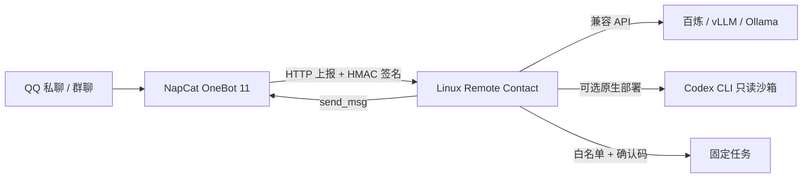

# Linux Remote Contact

运行在 Linux / 阿里云 ECS 上的个人 QQ AI 联系中枢。通过 OneBot 11 接收 QQ 消息，调用模型，保存独立会话，并在用户确认后执行管理员定义的任务。

本项目参考 [Codex-Remote-Contact](https://github.com/Epic0522/Codex-Remote-Contact) 的产品思路独立编写，没有复制其源代码。它不是原项目的 Linux 补丁，也没有原项目的全部功能。第一版支持文本，不支持 iMessage、图片理解、语音、群成员画像、自动训练和任意指令式电脑控制。

## 能实现什么

- QQ 私聊 AI；群聊必须同时满足用户白名单、群白名单以及 @ 机器人。
- `/状态` 查看服务状态，`/重置` 清除当前会话。
- `/任务` 查看管理员预设任务，`/运行 disk` 获取确认码，`/确认 确认码` 执行。
- 用户、群聊、私聊之间隔离上下文，保留最近 6 轮对话并落盘。
- API 后端支持百炼、vLLM、Ollama 的 Chat Completions 兼容接口；可选原生 Linux Codex CLI 后端。
- Web 页面查询状态；Docker Compose、健康检查、日志、Ubuntu CI。



## 1. 准备服务器

建议 Ubuntu 24.04 LTS x86_64、4 核 8 GB 内存、100 GB 系统盘；调用模型 API 不需要 GPU。服务器先安装 Git、Node.js 24、Docker Engine 和 Docker Compose 插件，参考 [Docker Ubuntu 官方安装说明](https://docs.docker.com/engine/install/ubuntu/)。

阿里云安全组仅向你的 IP 开放 SSH 22。默认无需域名、HTTPS、公网 Web 端口，管理通过 SSH 隧道访问。项目不会购买云资源或替你支付 API 费用。

## 2. 初始化配置

克隆你上传后的仓库，进入项目根目录，然后：

```bash
npm run init-env
chmod 600 .env
nano .env
```

初始化会生成四个不同的随机密钥，已有 `.env` 时拒绝覆盖。填写：

| 变量 | 作用 |
|---|---|
| `ALLOWED_USERS` | 你自己的 QQ 号，多个用英文逗号分隔；留空拒绝所有人 |
| `ALLOWED_GROUPS` | 允许的群号；留空禁用全部群聊 |
| `MODEL_BASE_URL` | 从模型服务控制台复制完整兼容接口 Base URL，不含 `/chat/completions` |
| `MODEL_API_KEY` | 模型 API 密钥；无鉴权的本地服务可留空 |
| `MODEL_NAME` | 模型服务提供的实际模型名称 |
| `MODEL_BACKEND` | `api` 或 `codex`，默认 `api` |
| `ENABLE_TASKS` | 默认 `false`；确认任务配置后才改为 `true` |

百炼示例以你账号的地域、业务空间实际配置为准；部分地域的 Base URL 包含 WorkspaceId，不能盲用示例地址。[百炼官方调用文档](https://help.aliyun.com/zh/model-studio/first-api-call-to-qwen)

本地模型示例（模型名必须已部署）：

```dotenv
MODEL_BACKEND=api
MODEL_BASE_URL=http://你的GPU服务器私网IP:8000/v1
MODEL_NAME=你的模型服务名称
MODEL_API_KEY=你的服务密钥
```

Ollama 通常使用 `http://主机地址:11434/v1`。容器内 `127.0.0.1` 指容器自身，模型在宿主机时需填写容器可访问的地址；模型端口限制在私网。此项目不负责安装模型或训练模型。

## 3. Docker 部署 QQ 版

```bash
docker compose --profile qq up -d --build
docker compose logs --tail=100 hub
docker compose ps
```

Compose 包含 hub 与可选 NapCat。NapCat 镜像固定为版本标签，部署前在 `.env` 的 `NAPCAT_TAG` 指定已核对的正式版本；镜像升级后重新验证登录和 OneBot 配置。不要使用不受控的自动更新。

在自己的电脑上建立隧道（将用户名和 IP 改成实际值）：

```bash
ssh -L 3789:127.0.0.1:3789 -L 6099:127.0.0.1:6099 ubuntu@你的ECS公网IP
```

打开 `http://127.0.0.1:6099`，使用 `.env` 中 `WEBUI_TOKEN` 登录 NapCat WebUI，完成 QQ 扫码登录。NapCat 自身的鉴权和首次设置以该版本 UI 为准。建议使用测试副号。

在 NapCat 的网络配置里新增两条连接：

| 连接 | 配置 |
|---|---|
| HTTP 服务端 | 监听 `0.0.0.0:3000`；access token = `.env` 的 `ONEBOT_TOKEN` |
| HTTP 客户端 / 主动上报 | 地址 `http://hub:3789/api/onebot/event`；启用事件上报；消息格式选择 `array` |
| 主动上报签名 | HMAC-SHA1 签名密钥 = `.env` 的 `ONEBOT_SECRET`，发送 `X-Signature: sha1=...` |

NapCat 不同版本可能把上报签名密钥标为 `secret` 或 `token`，应配置在 **HTTP 客户端上报连接**。它与 HTTP 服务端的 access token 用途不同。若返回 401，核对该版本实际是否用此值生成 `X-Signature`，不要关闭服务端验签。协议以 [OneBot 11 HTTP POST](https://github.com/botuniverse/onebot-11/blob/master/communication/http-post.md) 和 [NapCat 项目](https://github.com/NapNeko/NapCatQQ) 为准。

Compose 的 3000 端口只供容器网络访问，没有映射到公网。hub 的 3789 和 NapCat 的 6099 仅绑定宿主机回环地址。

打开 `http://127.0.0.1:3789`，输入 `ADMIN_TOKEN` 查询状态。页面不存储密钥，不显示密钥或聊天内容。`/healthz` 只表示主进程可用，不代表 QQ 登录与模型调用成功。

验收：先私聊机器人 `/状态`，再发送普通文字；启用任务后发送 `/运行 disk`，收到提示后复制 `/确认 ...`。群聊需 @ 机器人且用户、群都在白名单内。

## 4. 任务与权限

编辑 `config/tasks.json`，重启 hub 生效。每个任务由固定 executable、固定参数列表和超时组成，不接受来自 QQ 或模型的额外参数：

```json
{
  "disk": {
    "description": "查看工作目录磁盘空间",
    "command": "df",
    "args": ["-h", "."],
    "timeoutMs": 5000
  }
}
```

任务运行目录是 `WORKSPACE_DIR`。默认任务只查看内核和磁盘，Docker 内看到的是容器环境。任务以非 root 用户、无 shell 方式执行；环境变量不继承模型和管理密钥；60 秒确认码与会话绑定且只能消费一次。单任务输出最多 12 KB，QQ 回复最多 3500 字符。Linux 超时/超限时终止进程组。

这不是任意程序的完整安全沙箱：管理员配置的程序仍有当前运行用户的文件权限。不要配置 `sh -c`、`sudo` 或任意 Python eval 等可绕过固定参数限制的入口。需要训练/部署任务时，写一个固定参数脚本，并限制挂载目录和资源；不要给 hub 挂载 Docker socket。

## 5. 原生 Linux 与 Codex CLI

API 模式原生运行：

```bash
npm run init-env
# 编辑 .env，原生部署 ONEBOT_URL 指向实际 OneBot 地址
npm start
```

本项目本身没有第三方 npm 运行依赖，不必执行 npm install。Codex 模式需要单独安装官方 CLI、通过其官方认证流程登录，并在 `.env` 设置：

```dotenv
MODEL_BACKEND=codex
CODEX_BIN=/实际路径/codex
CODEX_HOME=/运行用户的实际目录/.codex
MODEL_TIMEOUT_MS=180000
```

程序使用 `codex exec --sandbox read-only --skip-git-repo-check --output-last-message <临时文件> -`，通过 stdin 传递 JSON 对话。仅使用运行用户已登录的 Codex 凭证；不会自动登录、购买套餐或绕过服务地区限制。参考 [Codex 非交互调用官方文档](https://developers.openai.com/codex/noninteractive)。不要把 Codex 凭证目录与 API 密钥文件放进任务工作目录。

CLI 在只读沙箱中回答，**不会自主修改服务器文件**。写入操作通过单独的预设任务完成。CLI 沙箱不是用户间文件隔离，各会话不要放置不同用户的机密文件。默认 Docker 镜像不含 Codex，Codex 模式请使用原生 Linux；不要为了运行 CLI 关闭容器安全限制。

可选 API 模式 systemd 模板见 `deploy/linux-remote-contact.service`；把 `/opt/linux-remote-contact`、Node 路径和 `contact` 用户改为实际值，不要使用 root。systemd 使用绝对配置路径，运行前先创建 data/workspace 并确认目录权限。模板的 `ProtectHome=true` 会阻止访问 home 内 Codex 凭证，不可直接用于 Codex 模式；Codex 应单独部署并按实际凭证位置配置文件访问。

## 6. 数据、日志与恢复

- `data/` 按会话哈希存储最近对话和任务审计 `audit.jsonl`，权限 600；Docker 对应 `hub-data` 卷。此数据未加密，请限制服务器与备份权限。
- `workspace/` 是任务工作目录，对应 `workspace` 卷。
- `.env`、运行数据、QQ 登录凭证从 Git 和构建上下文中排除。
- 容器标准日志轮转为 3 × 10 MB；`audit.jsonl` 需要管理员定期归档/轮转。
- 更改 `.env` 后执行 `docker compose --profile qq up -d`，而非仅 restart。
- 升级前停止 hub 并备份数据卷。不要使用 `docker compose down -v`，它会删除数据卷。
- 同一会话串行处理，不同会话最多总计排队 32 条；每用户每分钟最多 15 条。
- 5 分钟事件时间窗口、10 分钟内存去重；进程重启不保留去重记录，旧消息可能再次回复。
- 第一版采用立即 ACK + 内存队列，服务崩溃时在途消息可能丢失，不承诺持久队列或 exactly-once。任务确认码重启后失效，没有自动恢复/重试执行。
- API/QQ 调用失败只记录通用错误，不写入密钥或提供商错误正文，不自动重试付费模型或任务。

## 开发与验证

```bash
npm run check
npm test
HUB_ENV_FILE=.env.example docker compose --env-file .env.example config --quiet
docker build -t linux-remote-contact:test .
```

测试使用本机临时 HTTP 服务模拟 OneBot 和模型，不需要真实账号或收费调用。GitHub Actions 在 Ubuntu 上运行检查、测试与 Docker 构建。真实 QQ 登录、真实模型、Codex 认证与阿里云部署需要部署者验收。

## 与原思路的差别

保留联系中枢、会话、远程确认、模型后端的结构；把 macOS 专属消息数据库、AppleScript、Shadowrocket 依赖移除。原项目是 Mac 本机全能控制，本项目第一版是 Linux 文本联系与固定任务服务。需要 iMessage 时可以另接 Mac 网关，不是安装 Linux 就能拥有 iMessage。
