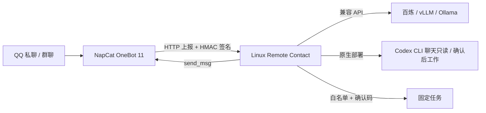

# Linux Remote Contact

运行在 Linux / 阿里云 ECS 上的个人 QQ AI 联系中枢。通过 OneBot 11 接收 QQ 消息，直接与 Codex 聊天，积累可管理的长期记忆，并在确认后执行任务。当前版本 0.5.1。

Ubuntu ECS 使用原生 Codex 时，推荐按 [ECS 部署与维护说明](deploy/ECS-HANDOFF.md) 部署：NapCat 单独使用 Docker，hub 交给 systemd，固定专用网桥地址并持久保存 QQ 登录数据。

## 你的使用路线：QQ + 现有 Codex 登录

这是适合“在QQ里有一个固定窗口，能聊天、记得我、帮我办事”的配置。运行 hub 的 Linux 用户需要单独完成 Codex 登录；电脑端登录不会自动出现在服务器上。无需为这条路线另配 GPT API Key。实际用量、额度和可用模型由你的 Codex 登录账户决定，不是无限免费。

1. 创建普通非 root Linux 用户，在其名下安装 Node.js 24 和官方 Codex CLI：`npm install -g @openai/codex`（版本需支持下文所用标志）。
2. 由用户本人运行 `codex login --device-auth`，按提示在浏览器完成授权。若账户未启用设备码登录，按官方说明启用或使用官方备用登录流程；不要把凭证贴到QQ或提交Git。参考 [Codex 官方认证说明](https://developers.openai.com/codex/auth)。
3. 克隆本项目，运行 `npm run init-env`，编辑 `.env`。保留 `MODEL_BACKEND=codex`、`ENABLE_CODEX_WORK=true`；填写 `ALLOWED_USERS`、可选 `ALLOWED_GROUPS`，以及 `CODEX_BIN` 的实际绝对路径。`CODEX_HOME` 可留空使用同一Linux用户的默认登录目录，或填写独立的实际凭证目录。
4. NapCat 用 Docker 运行，hub 原生运行。启动 NapCat：

```bash
docker compose -f compose.yaml -f compose.codex.yaml --profile qq up -d napcat
npm start
```

此组合不要再启动 `hub` 容器；默认镜像没有 Codex。原生 hub 使用 `.env` 中 `ONEBOT_URL=http://127.0.0.1:3000`。NapCat 的 HTTP 客户端不能再填 `http://hub:3789`：请填宿主机 Docker 网桥地址（在服务器用 `ip -4 addr show docker0` 查看）与 `/api/onebot/event`，并将原生 hub 的 `HOST` 绑定该网桥实际IPv4。NapCat HTTP服务端仍监听容器内 `0.0.0.0:3000`，覆盖文件仅把3000映射至宿主机回环地址。管理页SSH隧道相应指向该网桥地址的3789端口。保持验签与白名单；不把服务端口开放公网。也可让 OneBot 原生运行，这时 hub 保持 `HOST=127.0.0.1`，主动上报指向同机回环地址。

5. 私聊发送“你好，我叫小王，喜欢详细解释”，然后 `/记忆` 检查它记住了什么；用 `/设定 你叫小诺，说话自然，遇到不确定的事情坦率说明` 设置称呼与风格。
6. 发送“帮我写一个Python计算器，保存成文件”，Codex会在回复中提出任务。核对**实际任务内容**后，复制 `/确认 ...`。也可显式 `/干活 帮我写一个Python计算器`。完成后 `/结果 任务编号` 查看文件列表，`/文件 任务编号 calculator.py` 阅读UTF-8文本内容。

聊天与任务回复均为同一个Codex生成，QQ只负责传输；没有第二个模型改写答案。回复按2800个Unicode字符分段，附编号和间隔，不再取前3500字符。消息中如有记忆/任务提示，是程序附加的操作信息。QQ实际发送成功与风控状态仍需真实联调；分段失败不会自动重发整段。

## 连续消息接收延迟（0.5.1）

QQ上报仍立即验签并ACK；普通聊天在进入模型前等待最后一条消息后的安静窗口：私聊默认3秒、群聊默认4秒。每收到新消息重新计时，文字和图片一起合并，本批统一理解和回答。持续输入最多等待12秒，模型或任务忙碌产生的排队时间另计。模型已经开始处理时，新消息进入下一批，不取消或重复执行当前任务。

`.env` 中 `PRIVATE_DEBOUNCE_MS=3000`、`GROUP_DEBOUNCE_MS=4000` 和 `CHAT_MAX_WAIT_MS=12000` 可调整；最长等待须不小于两种安静窗口。`/`命令和入群通知立即封住前一批，不额外等待，但仍按会话先后执行。个人记忆从本批所有新消息提取，群成员身份继续按QQ号区分。审计只记录批次数量和等待时长，不记录消息正文。

服务常驻的是中枢程序，每批聊天通过后台 `codex exec` 运行一次；它把近期历史、长期记忆、身份和当前图片传入，不打开可见终端窗口。聊天阶段只返回结构化正文/记忆/操作提案；确认后的 `/干活` 才另起Codex进程在独立任务目录写文件。任务返回完成说明，产物目前通过 `/结果` 列目录、`/文件` 读取UTF-8文本（64KB），尚未上传图片或Word/PDF附件。普通回复固定送回当前会话，跨群发送尚未接入；不能用任意shell代替未提供的QQ工具。

## 图片理解（0.5）

私聊直接发送图片，可在同一条消息附上问题；小群无需 @，仍由 Codex 按语境决定是否回复。程序下载 QQ 图片原图，通过官方 CLI 的 `--image` 参数附给现有 Codex 登录账户，没有额外的识图模型或 OpenAI API Key。参考 [OpenAI Docs 图片输入说明](https://learn.chatgpt.com/docs/image-inputs?surface=cli)。

支持 PNG、JPEG、WebP，以及 GIF 的第一帧（不理解完整动画）。GIF 需要宿主机安装 `ffmpeg`，Ubuntu 可执行 `sudo apt-get install --no-install-recommends ffmpeg`；缺少转换器会明确提示重发静态图片。每张最多 8 MB，每条消息最多 3 张，每批最多尝试 4 张、总下载量最多 16 MB。群聊附件按消息序号与真实发言人 QQ 号对应。暂不解析合并转发、视频、语音输入和空间帖子中的图片。API 后端尚未接入图片。

仅从 QQ 的 HTTPS 图片域名取图，拒绝本地文件路径、任意外部网址和重定向；图片令牌、下载 URL 不进入聊天历史或模型提示。原图放入权限受限的临时目录，本轮结束或失败后删除。原图不会长期保存；后续可参考已生成的文字描述，需要重新看细节时请重发。下载失败/格式超限会明确标记，不能冒充已看见。识图会消耗现有 Codex 账户额度。

## 记忆与群聊

近期记忆保存最近6轮对话。长期记忆每个会话最多100条，每条400字符；每轮由**同一次Codex响应**提取最多3条非敏感偏好/约定。通过schema同时返回正文、记忆和任务提议，不额外调用模型总结回复。只有非敏感长期信息才应进入记忆，模型可能提取错误，需自行检查。显式保存/纠正的记忆不会被自动覆盖；达到100条后新条目不再自动加入，原条目仍可更新。

| QQ 命令 | 行为 |
|---|---|
| `/记忆` | 查看当前会话的长期记忆编号、设定、自动记忆开关 |
| `/记住 内容` | 显式保存一条非敏感信息 |
| `/纠正 编号 新内容` | 修改记忆，并清空近期上下文，避免旧说法影响 |
| `/忘记 编号` | 删除该条，并清空近期上下文 |
| `/重置` | 只清空近期对话，保留长期记忆和设定 |
| `/清空记忆` | 清空近期对话、长期记忆、设定，不删除任务文件 |
| `/自动记忆 开` / `/自动记忆 关` | 控制当前会话自动积累；关闭后已有记忆仍参与回答 |
| `/设定 内容` | 设置当前会话的名称和交流风格，不改变权限 |
| `/取消` | 取消未确认任务，不能打断正在运行的任务 |

私聊中是一个普通QQ联系人窗口。普通群聊配置 `ALLOWED_GROUPS` 并 @ 机器人，同时发言人必须在 `ALLOWED_USERS`；下节的小群模式可单独开启无需 @ 的参与。私聊、各群、各用户的个人记忆与任务结果均按会话键分开，不会把私聊记忆自动带到群里。小群模式共享群内近期上下文，并参考各成员在本群的个人档案。群内回复对所有群成员可见，不要在群里交办私密任务。

长期记忆是可编辑的数据，不是重新训练模型，也不意味着它有意识或真正像儿童一样成长。记忆保存在服务器，卸载或重建时需要备份数据目录。

## 小群全消息参与（0.3）

可对指定的小群开启无需 @ 的参与模式。QQ 主动上报新消息，默认等待最后一条消息后4秒，将连续消息合并给 Codex，由同一次响应返回 `shouldReply` 判断是否开口。模型忙碌期间到达的连续消息会合并为下一批，保留每条消息及其发言人，不按每句话分别积压模型调用。`GROUP_DEBOUNCE_MS` 可调整合并等待时间。选择安静时不发送空消息或“已读”，仍保留群上下文并可分别更新本批发言者的个人记忆。管理命令由程序直接处理，形成批次边界，保持先后顺序。机器人自己的消息不会再次进入模型。

群内最近60条上下文共享，用户发言绑定真实 QQ 号和显示名。长期记忆按“群号＋发言人QQ号”分别保存；私聊、其他群的资料不会自动带入。仅从当前发言者明确的自述提取个人偏好和约定，不把一个人对另一个人的猜测自动记成后者的事实。记忆可能有误，每人可以 `/记忆` 查看自己的资料、用 `/纠正 编号 内容` 修正；`/认识` 查看本群各成员档案。

管理员复制 [身份配置示例](config/identity.example.json) 到受限配置路径，填写创造者、机器人和初始成员的实际 QQ 号；设置 `COMPANION_IDENTITY_FILE` 指向该文件，并将目标群加入 `ALLOWED_GROUPS`。创造者必须在 `ALLOWED_USERS` 中；其他群友不必加入私聊白名单。该文件需允许服务用户读取，但应由管理员管理，不能作为普通对话记忆修改。示例 `config/identity.local.json` 已被 Git 忽略，生产可放在 `/etc/linux-contact/identity.json`。原有群若未配置此名册，继续要求用户白名单与 @；其他群不受此模式影响。

固定创造者关系每轮都重新注入模型，不依赖近60条上下文或可清空的记忆。任何群名片、普通发言、`/设定`、`/重置` 和 `/清空记忆` 都不能修改账号绑定；称呼可由模型根据语境自然选择。群内只有创造者能修改助手设定、重置共享上下文、提出和确认服务器任务；其他成员可以聊天、管理自己的个人记忆，不能确认创造者的任务。

新成员的入群通知或首次发言会触发独立登记，并标为“新成员／待了解”。`/新成员` 单独列出这些账号；他们可以参与本群聊天，资料随对话补充，不会获得私聊或任务权限。显示名可能重复，身份始终按 QQ 号区分。离群者的已知资料保留，新成员标签由管理员更新初始名册后解除。

Codex 后端支持本批新消息中的图片原图；语音输入尚未转写，仅保留类型占位。每批群消息判断都会消耗 Codex 额度，即使模型选择不回复。每人每分钟最多60条、全服务最多32条排队/运行；超限会返回429/503，不承诺无限量收录。已有群历史不会自动导入，启用后只接收新消息。

## 语音与QQ空间（0.4）

文字大脑继续使用已有Codex登录，语音服务只负责按原文合成音频。Codex在同一次结构化响应中给出正文和语气说明；QQ先收到完整文字，再收到对应语音条。短回复可自动选择语音，代码、报告和管理操作通常保持文字。自动语音同一会话间隔至少30秒；超过单次字数限制时只保留完整文字，不截断成不完整语音。语音合成或发送失败会明确提示，不重发已经发送的正文。

| QQ命令 | 功能 |
| --- | --- |
| `/能力` 或 `/自身说明` | 查看程序提供的真实能力状态，不包含密钥 |
| `/声线` | 查看语音是否配置以及使用的模型 |
| `/语音 内容` | 朗读指定文字并同时发送对应文字 |
| `/语音模式 自动`、`按需`、`关闭` | 设置当前会话自动语音；群中仅创造者可修改，显式 `/语音` 仍可调用 |
| `/空间动态` | 创造者私聊读取至多5条好友动态 |
| `/空间说说 [QQ号]` | 读取本人或指定账号可访问的说说 |
| `/空间资料 [QQ号]` | 读取空间名称与说明 |
| `/空间详情 Tid [QQ号]` | 读取说说详情；图片只显示数量，尚不理解图片 |
| `/发动态 完整正文` | 提出仅好友可见的纯文字说说草稿，等待确认 |
| `/昵称 内容`、`/签名 内容`、`/头像 HTTPS图片地址` | 提出资料修改，等待确认 |
| `/唱歌 曲风\|原创歌词` | 已配置独立音乐服务时提出歌曲生成，等待确认 |

自然语言也可提出上述请求。空间、资料与音乐操作只对创造者私聊开放；群聊不会因为被提到而代发说说或修改资料。外部动态经字段过滤后交给Codex总结，不作为授权或自动长期记忆；一次只读一个接口，读取结果不能引发后续写操作。发表和资料修改的确认码绑定当前会话，5分钟有效、只能用一次；失败或结果未知时不自动重试。空间发表默认仅好友可见，每天最多3条；本版没有定时自行发说说。头像限QQ CDN、阿里云OSS或GitHub图片的HTTPS链接，下载后验证PNG/JPEG并以base64传给QQ，不接受本地文件路径。

语音配置参考 [voice.example.json](config/voice.example.json)，生产建议存 `/etc/linux-contact/voice.json`，root:contact、640，`.env` 设置 `TTS_CONFIG_FILE`。支持CosyVoice v3.5/v3及Qwen-Audio-TTS 3.0/3.1；音色必须使用它创建时绑定的模型。API Key和带签名音频地址不进入模型上下文或日志；外部语音服务凭据不会传入Codex子进程。默认每段最多600字、每日合成10000字符，额度按北京时间日期持久保存；失败请求保守计入额度。文本聊天不受语音额度限制。详见 [百炼语音HTTP协议](https://help.aliyun.com/en/model-studio/qwen-audio-tts-http-api)。

`ENABLE_QQ_SOCIAL=true` 开启QQ空间与资料操作，使用NapCat已经登录的QQ账号，不需要百炼Key。实际可用性受账号空间是否开通、权限与QQ版本影响；注册了接口不等于该账号每项都已实测。相关接口来自 [NapCat](https://napneko.github.io/onebot/api)，并非腾讯的公开稳定机器人契约。

唱歌使用独立音乐服务，配置参考 [music.example.json](config/music.example.json)，设置 `MUSIC_CONFIG_FILE` 后启用；默认每日最多2首。只有百炼语音Key时保持关闭并明确说明。音乐调用按确认的原创歌词和曲风生成，歌声音色不保证与日常说话一致。音乐服务另计费用，不使用Codex登录或百炼语音Key。[音乐接口](https://platform.minimax.cn/docs/api-reference/music-generation)

## Codex任务边界

聊天阶段使用read-only沙箱并指示Codex不调用命令；写入任务必须经过QQ确认，使用workspace-write沙箱，工作目录是新的随机任务子目录。忽略用户配置和execpolicy规则、使用临时会话以避免继承自定义MCP/钩子或更宽权限。不使用danger-full-access；不启用网络；不允许请求升级权限。`CODEX_MODEL` 可填账户可用的模型名，留空使用CLI默认模型。

Codex原生沙箱不是完整的操作系统用户隔离：read-only仍可能读取同一Linux用户可读的其他文件，提示词禁止读取并不能替代文件权限。请用专门的服务用户，仅放自己授权给助手的数据；不要让不受信任的群成员进入白名单，也不要把私密文件放在服务用户能读的其他目录。需要多租户强隔离时需另加独立用户或容器沙箱。

任务返回成功只表示CLI流程正常结束，不代表产物一定正确；请检查结果。超时或失败可能留有部分文件，不自动重试；服务重启不会恢复在途任务，旧的running记录可能需要人工检查。`/文件` 只允许当前会话结果目录内的UTF-8文本（最大64KB），拒绝路径穿越和越界符号链接；二进制文件通过SSH取回。任务目录互相独立，当前不支持直接继续编辑上次任务，也不支持任意远程控制整台服务器。

本项目参考 [Codex-Remote-Contact](https://github.com/Epic0522/Codex-Remote-Contact) 的产品思路独立编写，没有复制其源代码。它不是原项目的 Linux 补丁，也没有原项目的全部功能。当前支持文本、可选语音输出、群内个人档案、QQ空间及资料操作；不支持 iMessage、图片理解、语音输入理解、模型训练和任意指令式电脑控制。

## 能实现什么

- QQ 私聊 AI；普通群聊要求用户白名单、群白名单和 @；指定小群可按身份名册开启全消息参与。
- `/状态` 查看服务状态，`/重置` 清除当前会话。
- `/任务` 查看管理员预设任务，`/运行 disk` 获取确认码，`/确认 确认码` 执行。
- 用户、群聊、私聊之间隔离上下文，保留最近 6 轮对话并落盘。
- 默认使用原生 Linux Codex CLI；可切换百炼、vLLM、Ollama 的兼容API后端。自动记忆提取与自然任务提议目前只接入Codex后端；API后端支持手动记忆和上下文注入。
- Web 页面查询状态；Docker Compose、健康检查、日志、Ubuntu CI。



## 1. 准备服务器

建议 Ubuntu 24.04 LTS x86_64、4 核 8 GB 内存、100 GB 系统盘；调用模型 API 不需要 GPU。服务器先安装 Git、Node.js 24、Docker Engine 和 Docker Compose 插件，参考 [Docker Ubuntu 官方安装说明](https://docs.docker.com/engine/install/ubuntu/)。

阿里云安全组仅向你的 IP 开放 SSH 22。默认无需域名、HTTPS、公网 Web 端口，管理通过 SSH 隧道访问。项目不会购买云资源或替你支付 API 费用。

## 2. 初始化配置

克隆你上传后的仓库，进入项目根目录，然后：

```bash
npm run init-env
chmod 600 .env
nano .env
```

初始化会生成四个不同的随机密钥，已有 `.env` 时拒绝覆盖。填写：

| 变量 | 作用 |
|---|---|
| `ALLOWED_USERS` | 你自己的 QQ 号，多个用英文逗号分隔；留空拒绝所有人 |
| `ALLOWED_GROUPS` | 允许的群号；留空禁用全部群聊 |
| `MODEL_BASE_URL` | 从模型服务控制台复制完整兼容接口 Base URL，不含 `/chat/completions` |
| `MODEL_API_KEY` | 模型 API 密钥；无鉴权的本地服务可留空 |
| `MODEL_NAME` | 模型服务提供的实际模型名称 |
| `MODEL_BACKEND` | `api` 或 `codex`，示例配置默认 `codex` |
| `ENABLE_TASKS` | 默认 `false`；确认任务配置后才改为 `true` |

百炼示例以你账号的地域、业务空间实际配置为准；部分地域的 Base URL 包含 WorkspaceId，不能盲用示例地址。[百炼官方调用文档](https://help.aliyun.com/zh/model-studio/first-api-call-to-qwen)

本地模型示例（模型名必须已部署）：

```dotenv
MODEL_BACKEND=api
MODEL_BASE_URL=http://你的GPU服务器私网IP:8000/v1
MODEL_NAME=你的模型服务名称
MODEL_API_KEY=你的服务密钥
```

Ollama 通常使用 `http://主机地址:11434/v1`。容器内 `127.0.0.1` 指容器自身，模型在宿主机时需填写容器可访问的地址；模型端口限制在私网。此项目不负责安装模型或训练模型。

## 3. Docker 部署 API 模式 QQ 版

本节仅适用于API后端，先在 `.env` 中设 `MODEL_BACKEND=api`、`ENABLE_CODEX_WORK=false`，填写对应模型信息。Codex用户按文首原生部署路线。

```bash
docker compose --profile qq up -d --build
docker compose logs --tail=100 hub
docker compose ps
```

Compose 包含 hub 与可选 NapCat。NapCat 镜像固定为版本标签，部署前在 `.env` 的 `NAPCAT_TAG` 指定已核对的正式版本；镜像升级后重新验证登录和 OneBot 配置。不要使用不受控的自动更新。

在自己的电脑上建立隧道（将用户名和 IP 改成实际值）：

```bash
ssh -L 3789:127.0.0.1:3789 -L 6099:127.0.0.1:6099 ubuntu@你的ECS公网IP
```

打开 `http://127.0.0.1:6099`，使用 `.env` 中 `WEBUI_TOKEN` 登录 NapCat WebUI，完成 QQ 扫码登录。NapCat 自身的鉴权和首次设置以该版本 UI 为准。建议使用测试副号。

在 NapCat 的网络配置里新增两条连接：

| 连接 | 配置 |
|---|---|
| HTTP 服务端 | 监听 `0.0.0.0:3000`；access token = `.env` 的 `ONEBOT_TOKEN` |
| HTTP 客户端 / 主动上报 | 地址 `http://hub:3789/api/onebot/event`；启用事件上报；消息格式选择 `array` |
| 主动上报签名 | HMAC-SHA1 签名密钥 = `.env` 的 `ONEBOT_SECRET`，发送 `X-Signature: sha1=...` |

NapCat 不同版本可能把上报签名密钥标为 `secret` 或 `token`，应配置在 **HTTP 客户端上报连接**。它与 HTTP 服务端的 access token 用途不同。若返回 401，核对该版本实际是否用此值生成 `X-Signature`，不要关闭服务端验签。协议以 [OneBot 11 HTTP POST](https://github.com/botuniverse/onebot-11/blob/master/communication/http-post.md) 和 [NapCat 项目](https://github.com/NapNeko/NapCatQQ) 为准。

Compose 的 3000 端口只供容器网络访问，没有映射到公网。hub 的 3789 和 NapCat 的 6099 仅绑定宿主机回环地址。

打开 `http://127.0.0.1:3789`，输入 `ADMIN_TOKEN` 查询状态。页面不存储密钥，不显示密钥或聊天内容。`/healthz` 只表示主进程可用，不代表 QQ 登录与模型调用成功。

验收：先私聊机器人 `/状态`，再发送普通文字；启用任务后发送 `/运行 disk`，收到提示后复制 `/确认 ...`。群聊需 @ 机器人且用户、群都在白名单内。

## 4. 任务与权限

编辑 `config/tasks.json`，重启 hub 生效。每个任务由固定 executable、固定参数列表和超时组成，不接受来自 QQ 或模型的额外参数：

```json
{
  "disk": {
    "description": "查看工作目录磁盘空间",
    "command": "df",
    "args": ["-h", "."],
    "timeoutMs": 5000
  }
}
```

预设任务运行目录是 `WORKSPACE_DIR`。默认预设任务只查看内核和磁盘，Docker 内看到的是容器环境。任务以非 root 用户、无 shell 方式执行；环境变量不继承模型和管理密钥；60 秒确认码与会话绑定且只能消费一次。预设任务输出上限12KB，超限会终止进程并明确提示；QQ回复分段发送。Linux 超时/超限时终止进程组。

这不是任意程序的完整安全沙箱：管理员配置的程序仍有当前运行用户的文件权限。不要配置 `sh -c`、`sudo` 或任意 Python eval 等可绕过固定参数限制的入口。需要训练/部署任务时，写一个固定参数脚本，并限制挂载目录和资源；不要给 hub 挂载 Docker socket。

## 5. 原生 Linux 与 Codex CLI

API 模式原生运行：

```bash
npm run init-env
# 编辑 .env，原生部署 ONEBOT_URL 指向实际 OneBot 地址
npm start
```

本项目本身没有第三方 npm 运行依赖，不必执行 npm install。Codex 模式需要单独安装官方 CLI、通过其官方认证流程登录，并在 `.env` 设置：

```dotenv
MODEL_BACKEND=codex
CODEX_BIN=/实际路径/codex
CODEX_HOME=/运行用户的实际目录/.codex
MODEL_TIMEOUT_MS=180000
```

程序使用 `codex --ask-for-approval never exec --sandbox read-only --skip-git-repo-check --output-last-message <临时文件> --ignore-user-config --ignore-rules --ephemeral --output-schema <schema> -`，通过 stdin 传递 JSON 对话；确认后任务使用workspace-write，不带聊天schema。CLI需支持这些官方标志，不支持时升级或参考对应版本文档，不要删除沙箱参数。仅使用运行用户已登录的 Codex 凭证；不会自动登录、购买套餐或绕过服务地区限制。参考 [Codex 非交互调用官方文档](https://developers.openai.com/codex/noninteractive)。不要把 Codex 凭证目录与 API 密钥文件放进任务工作目录。

CLI在聊天阶段只读回答，写入通过确认后任务完成。CLI沙箱不是用户间文件隔离，各会话不要放置不同用户的机密文件。默认Docker镜像不含Codex，Codex模式请使用原生Linux；不要为了运行CLI关闭容器安全限制。

可选 API 模式 systemd 模板见 `deploy/linux-remote-contact.service`；把 `/opt/linux-remote-contact`、Node 路径和 `contact` 用户改为实际值，不要使用 root。systemd 使用绝对配置路径，运行前先创建 data/workspace 并确认目录权限。模板的 `ProtectHome=true` 会阻止访问 home 内 Codex 凭证，不可直接用于 Codex 模式；Codex 应单独部署并按实际凭证位置配置文件访问。

## 6. 数据、日志与恢复

- `data/` 按会话哈希存储最近对话和任务审计 `audit.jsonl`，权限 600；Docker 对应 `hub-data` 卷。此数据未加密，请限制服务器与备份权限。
- `workspace/` 是任务工作目录，对应 `workspace` 卷。
- `.env`、运行数据、QQ 登录凭证从 Git 和构建上下文中排除。
- 容器标准日志轮转为 3 × 10 MB；`audit.jsonl` 需要管理员定期归档/轮转。
- 更改 `.env` 后执行 `docker compose --profile qq up -d`，而非仅 restart。
- 升级前停止 hub 并备份数据卷。不要使用 `docker compose down -v`，它会删除数据卷。
- 同一会话串行处理，不同会话最多总计排队 32 条；每用户每分钟最多 15 条。
- 5 分钟事件时间窗口、10 分钟内存去重；进程重启不保留去重记录，旧消息可能再次回复。
- 第一版采用立即 ACK + 内存队列，服务崩溃时在途消息可能丢失，不承诺持久队列或 exactly-once。任务确认码重启后失效，没有自动恢复/重试执行。
- API/QQ 调用失败只记录通用错误，不写入密钥或提供商错误正文，不自动重试付费模型或任务。

## 开发与验证

```bash
npm run check
npm test
HUB_ENV_FILE=.env.example docker compose --env-file .env.example config --quiet
docker build -t linux-remote-contact:test .
```

测试使用本机临时 HTTP 服务模拟 OneBot 和模型，不需要真实账号或收费调用。GitHub Actions 在 Ubuntu 上运行检查、测试与 Docker 构建。真实 QQ 登录、真实模型、Codex 认证与阿里云部署需要部署者验收。

## 与原思路的差别

保留联系中枢、会话、远程确认、模型后端的结构；把 macOS 专属消息数据库、AppleScript、Shadowrocket 依赖移除。当前提供Linux文本聊天、可管理长期记忆与确认后Codex工作目录任务。需要iMessage时可以另接Mac网关，不是安装Linux就能拥有iMessage。
